# Filter benchmark

Same sensor data for every filter, scored against Gazebo ground truth from 2 s after takeoff (`testing/benchmark_filters.py`). Tilt = |roll/pitch error|, heading = |yaw error|, degrees. Madgwick/Mahony estimate attitude only. *Tuned* gains are the grid-search best over these same recordings (a best case for them); the EKF is not retuned. EKF2 exists only in PX4-flown SITL logs.

## flight_box  (73 s scored)

| filter | tilt rms | tilt p95 | tilt max | heading rms | heading max | pos h rms (m) | pos v rms (m) | vel rms (m/s) |
|---|---|---|---|---|---|---|---|---|
| **your EKF** | 0.01 | 0.02 | 0.04 | 0.02 | 0.08 | 0.01 | 0.02 | 0.03 |
| madgwick (default) | 0.89 | 1.85 | 2.05 | 1.13 | 3.99 | - | - | - |
| madgwick (tuned beta=0.001, zeta=0.0) | 0.27 | 0.45 | 0.50 | 0.07 | 0.16 | - | - | - |
| mahony (default) | 0.57 | 0.87 | 0.91 | 0.19 | 0.42 | - | - | - |
| mahony (tuned ki=0.0, kp=0.02) | 0.09 | 0.14 | 0.16 | 0.01 | 0.02 | - | - | - |

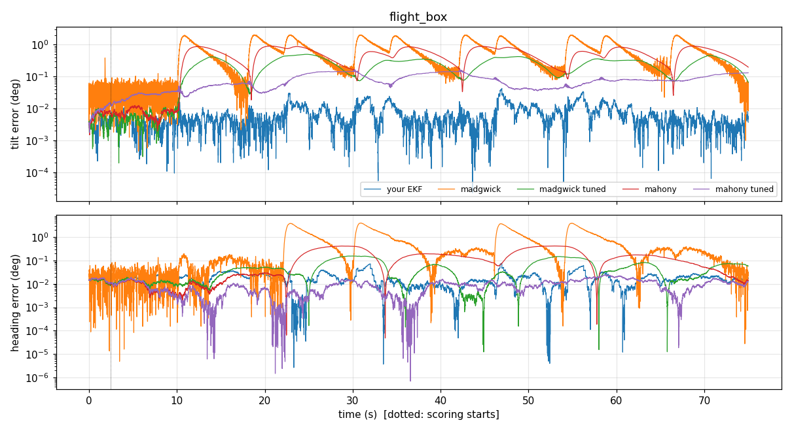

## flight_box_ct  (88 s scored)

| filter | tilt rms | tilt p95 | tilt max | heading rms | heading max | pos h rms (m) | pos v rms (m) | vel rms (m/s) |
|---|---|---|---|---|---|---|---|---|
| **your EKF** | 0.01 | 0.02 | 0.04 | 0.03 | 0.17 | 0.01 | 0.02 | 0.02 |
| madgwick (default) | 0.81 | 1.82 | 2.04 | 1.02 | 3.98 | - | - | - |
| madgwick (tuned beta=0.001, zeta=0.0) | 0.25 | 0.46 | 0.51 | 0.07 | 0.26 | - | - | - |
| mahony (default) | 0.51 | 0.87 | 0.92 | 0.18 | 0.45 | - | - | - |
| mahony (tuned ki=0.0, kp=0.02) | 0.18 | 0.29 | 0.31 | 0.07 | 0.26 | - | - | - |

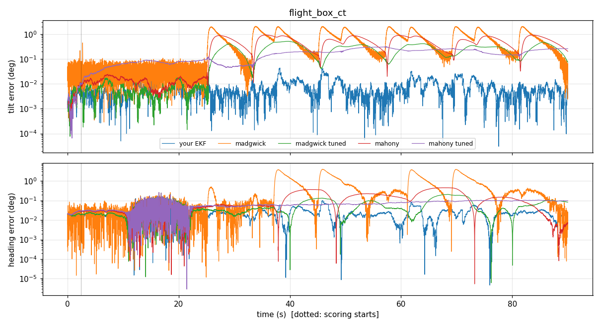

## flight_circle_fast  (73 s scored)

| filter | tilt rms | tilt p95 | tilt max | heading rms | heading max | pos h rms (m) | pos v rms (m) | vel rms (m/s) |
|---|---|---|---|---|---|---|---|---|
| **your EKF** | 0.16 | 0.30 | 0.47 | 0.30 | 0.91 | 0.06 | 0.02 | 0.11 |
| madgwick (default) | 8.17 | 11.57 | 13.15 | 7.94 | 17.78 | - | - | - |
| madgwick (tuned beta=0.001, zeta=0.0) | 0.19 | 0.30 | 0.38 | 0.09 | 0.16 | - | - | - |
| mahony (default) | 4.31 | 6.42 | 6.81 | 4.00 | 6.58 | - | - | - |
| mahony (tuned ki=0.0, kp=0.02) | 0.24 | 0.35 | 0.46 | 0.15 | 0.23 | - | - | - |

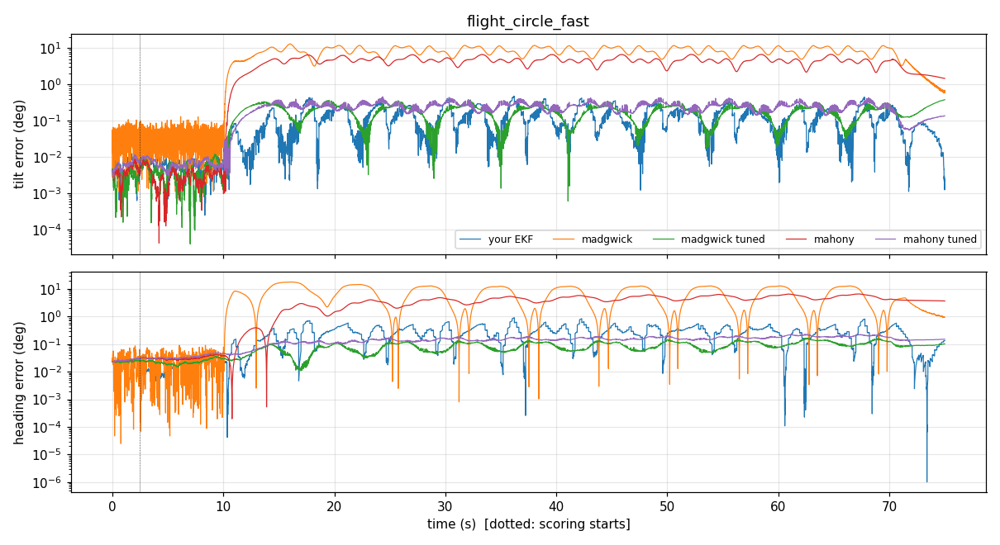

## flight_circle_slow  (73 s scored)

| filter | tilt rms | tilt p95 | tilt max | heading rms | heading max | pos h rms (m) | pos v rms (m) | vel rms (m/s) |
|---|---|---|---|---|---|---|---|---|
| **your EKF** | 0.01 | 0.02 | 0.05 | 0.08 | 0.17 | 0.02 | 0.01 | 0.03 |
| madgwick (default) | 1.98 | 2.26 | 3.07 | 2.83 | 5.89 | - | - | - |
| madgwick (tuned beta=0.001, zeta=0.0) | 0.32 | 0.42 | 0.46 | 0.09 | 0.16 | - | - | - |
| mahony (default) | 1.32 | 1.80 | 1.86 | 0.43 | 0.86 | - | - | - |
| mahony (tuned ki=0.0, kp=0.02) | 0.14 | 0.23 | 0.25 | 0.15 | 0.23 | - | - | - |

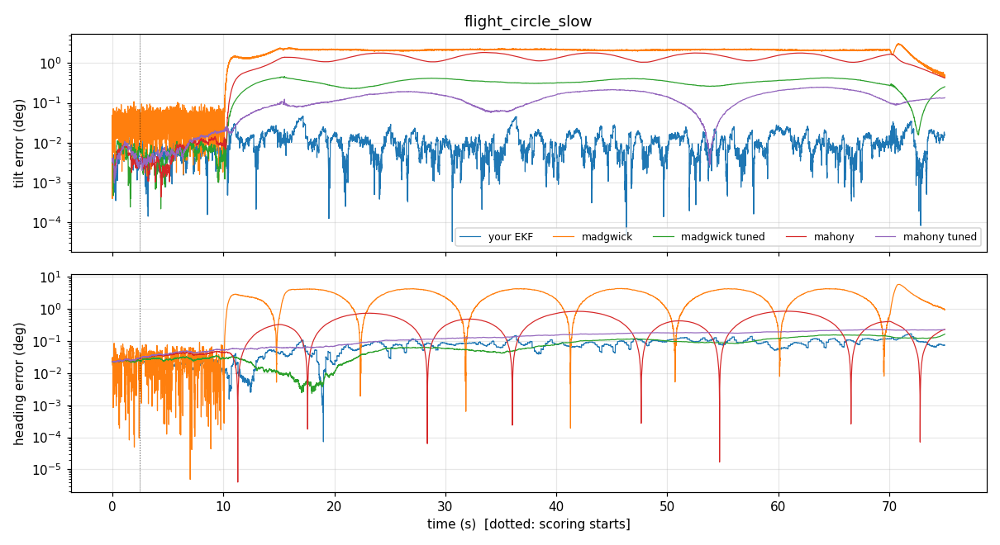

## flight_hover  (73 s scored)

| filter | tilt rms | tilt p95 | tilt max | heading rms | heading max | pos h rms (m) | pos v rms (m) | vel rms (m/s) |
|---|---|---|---|---|---|---|---|---|
| **your EKF** | 0.00 | 0.01 | 0.01 | 0.02 | 0.03 | 0.00 | 0.01 | 0.00 |
| madgwick (default) | 0.04 | 0.06 | 0.13 | 0.03 | 0.10 | - | - | - |
| madgwick (tuned beta=0.001, zeta=0.0) | 0.00 | 0.01 | 0.01 | 0.01 | 0.02 | - | - | - |
| mahony (default) | 0.01 | 0.01 | 0.02 | 0.01 | 0.02 | - | - | - |
| mahony (tuned ki=0.0, kp=0.02) | 0.06 | 0.08 | 0.09 | 0.06 | 0.11 | - | - | - |

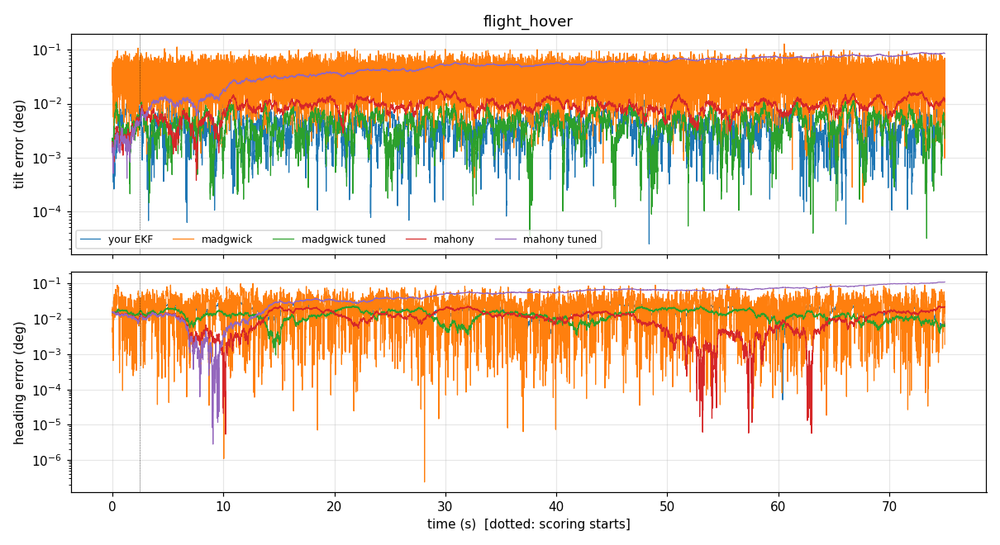

## flight_hover_ct  (88 s scored)

| filter | tilt rms | tilt p95 | tilt max | heading rms | heading max | pos h rms (m) | pos v rms (m) | vel rms (m/s) |
|---|---|---|---|---|---|---|---|---|
| **your EKF** | 0.01 | 0.01 | 0.03 | 0.03 | 0.25 | 0.00 | 0.02 | 0.00 |
| madgwick (default) | 0.04 | 0.07 | 0.21 | 0.04 | 0.24 | - | - | - |
| madgwick (tuned beta=0.001, zeta=0.0) | 0.01 | 0.01 | 0.02 | 0.03 | 0.26 | - | - | - |
| mahony (default) | 0.01 | 0.02 | 0.02 | 0.06 | 0.23 | - | - | - |
| mahony (tuned ki=0.0, kp=0.02) | 0.09 | 0.13 | 0.14 | 0.14 | 0.23 | - | - | - |

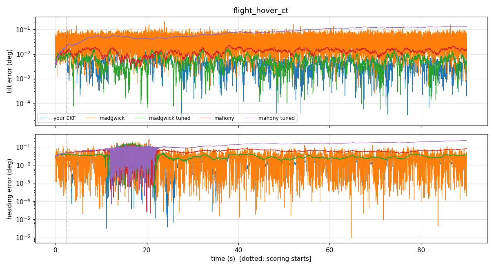

## flight_patrol_long  (613 s scored)

| filter | tilt rms | tilt p95 | tilt max | heading rms | heading max | pos h rms (m) | pos v rms (m) | vel rms (m/s) |
|---|---|---|---|---|---|---|---|---|
| **your EKF** | 0.02 | 0.02 | 0.46 | 0.04 | 0.79 | 0.01 | 0.01 | 0.04 |
| madgwick (default) | 0.97 | 1.86 | 3.30 | 1.35 | 4.01 | - | - | - |
| madgwick (tuned beta=0.001, zeta=0.0) | 0.42 | 0.48 | 2.70 | 0.13 | 0.39 | - | - | - |
| mahony (default) | 0.59 | 0.87 | 2.94 | 0.23 | 0.46 | - | - | - |
| mahony (tuned ki=0.0, kp=0.02) | 0.59 | 1.13 | 2.80 | 0.23 | 0.45 | - | - | - |

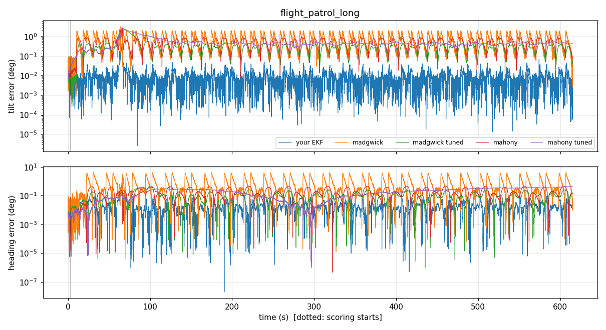

## flight_stops  (58 s scored)

| filter | tilt rms | tilt p95 | tilt max | heading rms | heading max | pos h rms (m) | pos v rms (m) | vel rms (m/s) |
|---|---|---|---|---|---|---|---|---|
| **your EKF** | 0.03 | 0.06 | 0.19 | 0.10 | 0.18 | 0.04 | 0.01 | 0.08 |
| madgwick (default) | 5.85 | 10.04 | 11.00 | 0.42 | 0.78 | - | - | - |
| madgwick (tuned beta=0.001, zeta=0.0) | 0.23 | 0.40 | 0.61 | 0.03 | 0.09 | - | - | - |
| mahony (default) | 3.18 | 4.87 | 5.09 | 0.11 | 0.21 | - | - | - |
| mahony (tuned ki=0.0, kp=0.02) | 0.26 | 0.45 | 0.64 | 0.04 | 0.10 | - | - | - |

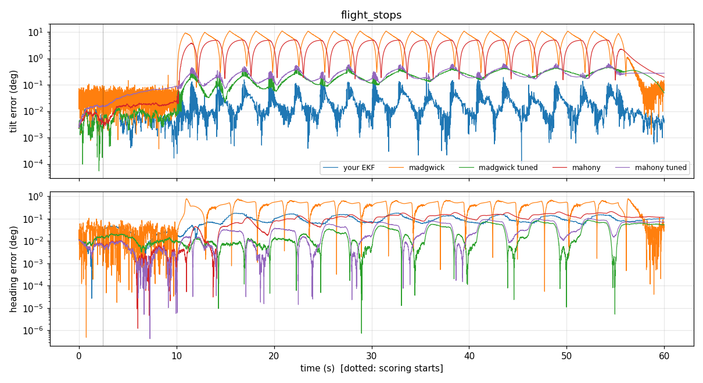

## flight_takeoff_land  (53 s scored)

| filter | tilt rms | tilt p95 | tilt max | heading rms | heading max | pos h rms (m) | pos v rms (m) | vel rms (m/s) |
|---|---|---|---|---|---|---|---|---|
| **your EKF** | 0.01 | 0.01 | 0.02 | 0.02 | 0.03 | 0.00 | 0.42 | 0.10 |
| madgwick (default) | 0.04 | 0.07 | 0.24 | 0.03 | 0.10 | - | - | - |
| madgwick (tuned beta=0.001, zeta=0.0) | 0.01 | 0.01 | 0.01 | 0.01 | 0.02 | - | - | - |
| mahony (default) | 0.01 | 0.02 | 0.02 | 0.03 | 0.05 | - | - | - |
| mahony (tuned ki=0.0, kp=0.02) | 0.14 | 0.19 | 0.20 | 0.12 | 0.20 | - | - | - |

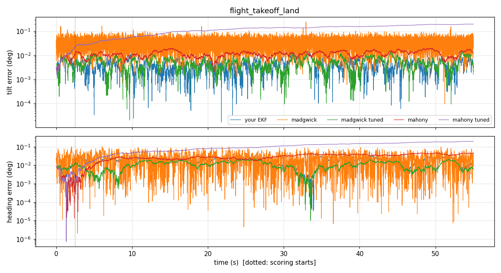

## flight_yaw_spin  (73 s scored)

| filter | tilt rms | tilt p95 | tilt max | heading rms | heading max | pos h rms (m) | pos v rms (m) | vel rms (m/s) |
|---|---|---|---|---|---|---|---|---|
| **your EKF** | 0.02 | 0.03 | 0.04 | 0.05 | 0.16 | 0.02 | 0.00 | 0.01 |
| madgwick (default) | 0.04 | 0.07 | 0.12 | 0.05 | 0.18 | - | - | - |
| madgwick (tuned beta=0.001, zeta=0.0) | 0.01 | 0.01 | 0.02 | 0.05 | 0.14 | - | - | - |
| mahony (default) | 0.02 | 0.03 | 0.03 | 0.08 | 0.16 | - | - | - |
| mahony (tuned ki=0.0, kp=0.02) | 0.07 | 0.08 | 0.09 | 0.21 | 0.39 | - | - | - |

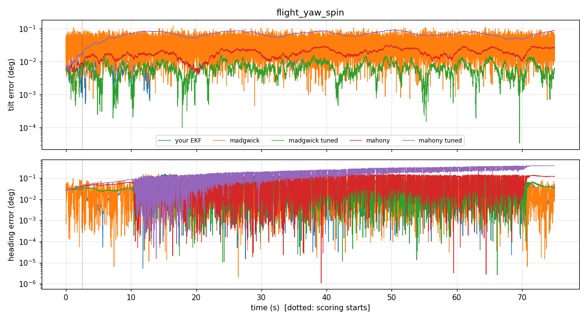

## flight_yaw_steps  (73 s scored)

| filter | tilt rms | tilt p95 | tilt max | heading rms | heading max | pos h rms (m) | pos v rms (m) | vel rms (m/s) |
|---|---|---|---|---|---|---|---|---|
| **your EKF** | 0.02 | 0.04 | 0.07 | 0.05 | 0.43 | 0.02 | 0.01 | 0.01 |
| madgwick (default) | 0.04 | 0.07 | 0.23 | 0.04 | 0.43 | - | - | - |
| madgwick (tuned beta=0.001, zeta=0.0) | 0.01 | 0.01 | 0.02 | 0.04 | 0.49 | - | - | - |
| mahony (default) | 0.01 | 0.01 | 0.02 | 0.04 | 0.48 | - | - | - |
| mahony (tuned ki=0.0, kp=0.02) | 0.04 | 0.07 | 0.08 | 0.04 | 0.50 | - | - | - |

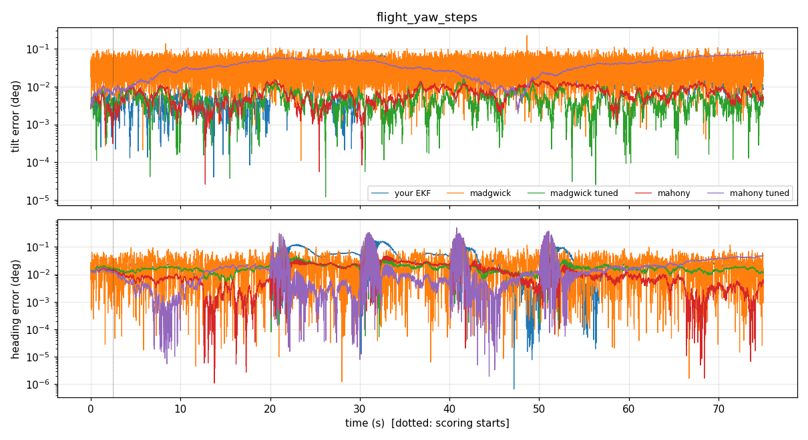

## sitl_flight1  (26 s scored)

| filter | tilt rms | tilt p95 | tilt max | heading rms | heading max | pos h rms (m) | pos v rms (m) | vel rms (m/s) |
|---|---|---|---|---|---|---|---|---|
| **your EKF** | 0.24 | 0.44 | 0.73 | 0.66 | 1.17 | 0.03 | 0.03 | 0.03 |
| PX4 EKF2 | 0.03 | 0.04 | 0.08 | 5.60 | 5.88 | 0.04 | 0.05 | 0.02 |
| madgwick (default) | 0.14 | 0.24 | 0.63 | 0.24 | 1.06 | - | - | - |
| madgwick (tuned beta=0.001, zeta=0.0) | 0.05 | 0.09 | 0.11 | 0.04 | 0.11 | - | - | - |
| mahony (default) | 0.06 | 0.10 | 0.14 | 0.04 | 0.07 | - | - | - |
| mahony (tuned ki=0.0, kp=0.02) | 0.12 | 0.16 | 0.16 | 0.08 | 0.11 | - | - | - |

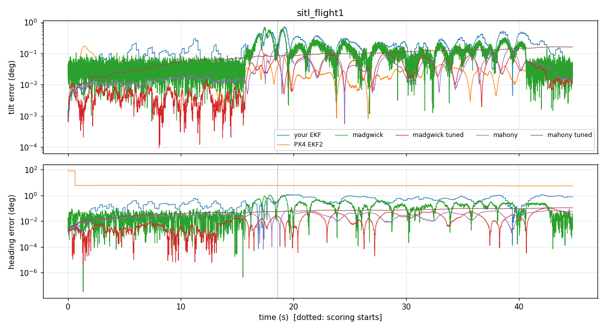

## Summary (mean over all recordings)

| filter | tilt rms | tilt max | heading rms | heading max |
|---|---|---|---|---|
| **your EKF** | 0.04 | 0.18 | 0.12 | 0.36 |
| madgwick (default) | 1.58 | 3.01 | 1.26 | 3.21 |
| madgwick (tuned beta=0.001, zeta=0.0) | 0.15 | 0.45 | 0.06 | 0.19 |
| mahony (default) | 0.88 | 1.56 | 0.45 | 0.83 |
| mahony (tuned ki=0.0, kp=0.02) | 0.17 | 0.45 | 0.11 | 0.24 |

### Gain sweep (mean tilt rms / heading rms over all recordings)

**madgwick**

| gains | tilt rms | heading rms |
|---|---|---|
| {"beta": 0.0, "zeta": 0.002} | 1.31 | 1.15 |
| {"beta": 0.0, "zeta": 0.01} | 1.84 | 1.72 |
| {"beta": 0.0, "zeta": 0.0} | 0.45 | 0.11 |
| {"beta": 0.001, "zeta": 0.002} | 0.88 | 0.91 |
| {"beta": 0.001, "zeta": 0.01} | 1.21 | 1.93 |
| {"beta": 0.001, "zeta": 0.0} | 0.15 | 0.06 |
| {"beta": 0.002, "zeta": 0.002} | 0.71 | 0.89 |
| {"beta": 0.002, "zeta": 0.01} | 1.13 | 2.31 |
| {"beta": 0.002, "zeta": 0.0} | 0.21 | 0.08 |
| {"beta": 0.005, "zeta": 0.002} | 0.63 | 0.85 |
| {"beta": 0.005, "zeta": 0.01} | 0.94 | 1.12 |
| {"beta": 0.005, "zeta": 0.0} | 0.37 | 0.22 |
| {"beta": 0.01, "zeta": 0.002} | 0.68 | 0.89 |
| {"beta": 0.01, "zeta": 0.01} | 0.88 | 1.07 |
| {"beta": 0.01, "zeta": 0.0} | 0.51 | 0.39 |
| {"beta": 0.02, "zeta": 0.002} | 0.82 | 0.88 |
| {"beta": 0.02, "zeta": 0.01} | 0.94 | 1.05 |
| {"beta": 0.02, "zeta": 0.0} | 0.70 | 0.55 |
| {"beta": 0.05, "zeta": 0.002} | 1.13 | 0.85 |
| {"beta": 0.05, "zeta": 0.01} | 1.25 | 1.16 |
| {"beta": 0.05, "zeta": 0.0} | 1.09 | 0.99 |
| {"beta": 0.1, "zeta": 0.002} | 1.59 | 1.19 |
| {"beta": 0.1, "zeta": 0.01} | 1.63 | 1.19 |
| {"beta": 0.1, "zeta": 0.0} | 1.58 | 1.26 |
| {"beta": 0.2, "zeta": 0.002} | 2.00 | 1.72 |
| {"beta": 0.2, "zeta": 0.01} | 2.00 | 1.72 |
| {"beta": 0.2, "zeta": 0.0} | 2.00 | 1.71 |

**mahony**

| gains | tilt rms | heading rms |
|---|---|---|
| {"ki": 0.0, "kp": 0.005} | 0.26 | 0.10 |
| {"ki": 0.0, "kp": 0.01} | 0.20 | 0.11 |
| {"ki": 0.0, "kp": 0.02} | 0.17 | 0.11 |
| {"ki": 0.0, "kp": 0.05} | 0.18 | 0.11 |
| {"ki": 0.0, "kp": 0.0} | 0.45 | 0.11 |
| {"ki": 0.0, "kp": 0.1} | 0.28 | 0.13 |
| {"ki": 0.0, "kp": 0.2} | 0.46 | 0.20 |
| {"ki": 0.0, "kp": 0.5} | 0.88 | 0.45 |
| {"ki": 0.0, "kp": 1.0} | 1.29 | 0.66 |
| {"ki": 0.0, "kp": 2.0} | 1.63 | 0.83 |
| {"ki": 0.01, "kp": 0.005} | 0.32 | 0.32 |
| {"ki": 0.01, "kp": 0.01} | 0.28 | 0.31 |
| {"ki": 0.01, "kp": 0.02} | 0.25 | 0.30 |
| {"ki": 0.01, "kp": 0.05} | 0.27 | 0.29 |
| {"ki": 0.01, "kp": 0.0} | 0.49 | 0.36 |
| {"ki": 0.01, "kp": 0.1} | 0.35 | 0.26 |
| {"ki": 0.01, "kp": 0.2} | 0.52 | 0.21 |
| {"ki": 0.01, "kp": 0.5} | 0.91 | 0.29 |
| {"ki": 0.01, "kp": 1.0} | 1.30 | 0.56 |
| {"ki": 0.01, "kp": 2.0} | 1.63 | 0.80 |
| {"ki": 0.05, "kp": 0.005} | 0.79 | 0.68 |
| {"ki": 0.05, "kp": 0.01} | 0.73 | 0.66 |
| {"ki": 0.05, "kp": 0.02} | 0.67 | 0.65 |
| {"ki": 0.05, "kp": 0.05} | 0.60 | 0.64 |
| {"ki": 0.05, "kp": 0.0} | 0.94 | 0.75 |
| {"ki": 0.05, "kp": 0.1} | 0.61 | 0.62 |
| {"ki": 0.05, "kp": 0.2} | 0.72 | 0.59 |
| {"ki": 0.05, "kp": 0.5} | 1.03 | 0.46 |
| {"ki": 0.05, "kp": 1.0} | 1.36 | 0.45 |
| {"ki": 0.05, "kp": 2.0} | 1.65 | 0.73 |
| {"ki": 0.2, "kp": 0.005} | 1.83 | 1.38 |
| {"ki": 0.2, "kp": 0.01} | 1.72 | 1.36 |
| {"ki": 0.2, "kp": 0.02} | 1.60 | 1.32 |
| {"ki": 0.2, "kp": 0.05} | 1.42 | 1.25 |
| {"ki": 0.2, "kp": 0.0} | 2.07 | 1.41 |
| {"ki": 0.2, "kp": 0.1} | 1.31 | 1.22 |
| {"ki": 0.2, "kp": 0.2} | 1.25 | 1.14 |
| {"ki": 0.2, "kp": 0.5} | 1.30 | 0.80 |
| {"ki": 0.2, "kp": 1.0} | 1.50 | 0.57 |
| {"ki": 0.2, "kp": 2.0} | 1.70 | 0.72 |

## Read before quoting these numbers

- **Gazebo's gyros are nearly ideal** (tiny noise, no bias drift), and the dwell hands every filter the
  exact gyro bias. That is why the *tuned* Madgwick/Mahony gains collapse toward zero (beta=0.001, kp=0.02):
  in this sim, near-pure gyro integration is almost free. On real hardware the bias drifts and such
  low gains would let the attitude wander. The *default* gains are what those filters normally run with.
- **The default Madgwick/Mahony failure in manoeuvres (circle_fast, stops) is the thrust problem**: both
  treat the accelerometer as gravity, but in flight it measures thrust along body z, so they are pulled
  toward level whenever the drone tilts to accelerate. Your EKF turns accel-as-gravity off in flight and
  gets tilt from GPS velocity instead - that is the main reason it wins there.
- **EKF2's 5.6 deg heading on sitl_flight1 is mostly a reference mismatch, not filter error**:
  ulog_to_csv.py measured the field direction with the ground-truth attitude and handed it to your EKF,
  Madgwick and Mahony; EKF2 uses the World Magnetic Model declination, which does not match Gazebo's field.
- **Only one EKF2 log** (takeoff, ~25 s hover, land). EKF2's tilt advantage there (0.03 vs 0.24 deg) is real
  but measured on very little motion; a manoeuvring PX4-flown SITL flight would say much more.
